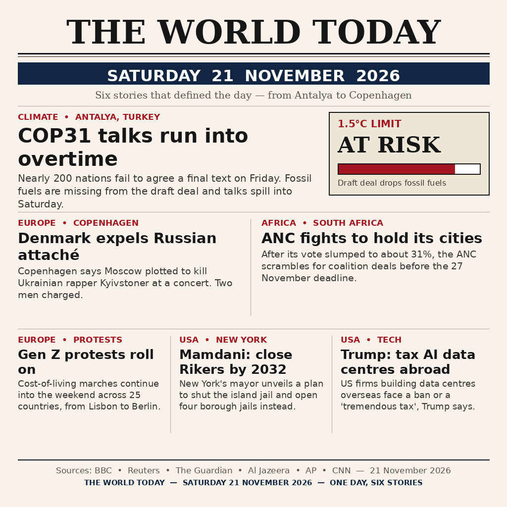

[](https://make.fun/bounty/news-image-20261121?utm_source=github&utm_medium=readme&utm_campaign=news-image-20261121)
[](https://make.fun/bounty/news-image-20261121?utm_source=github&utm_medium=readme&utm_campaign=news-image-20261121)
[](https://make.fun/bounty/news-image-20261121?utm_source=github&utm_medium=readme&utm_campaign=news-image-20261121)

# THE WORLD TODAY — Saturday 21 November 2026

A one-page newspaper front page summing up the world's news of
Saturday 21 November 2026 in a single image: six stories, across
regions and fields, each verified against reporting dated
21 November 2026.



## The six stories

1. **COP31 talks run into overtime** — Antalya, Turkey. Nearly 200
   nations fail to agree a final text on Friday; fossil fuels are
   missing from the draft deal and talks spill into Saturday.
   Source: The Guardian (live, 21 Nov 2026, 07:04) / AP.
2. **Denmark expels Russian attaché** — Copenhagen. Denmark says
   Moscow plotted to kill Ukrainian rapper Kyivstoner at a concert
   near Copenhagen; two men charged.
   Source: Al Jazeera, published 21 Nov 2026 / BBC, 21 Nov 2026.
3. **ANC fights to hold its cities** — South Africa. After its vote
   slumped to about 31%, the ANC scrambles for coalition deals
   before the 27 November deadline.
   Source: BBC, 21 Nov 2026.
4. **Gen Z protests roll on** — Europe. Cost-of-living marches
   continue into the weekend across 25+ countries, from Lisbon
   to Berlin.
   Source: CNN / AFP, 20–22 Nov 2026 weekend of action.
5. **Mamdani: close Rikers by 2032** — New York, USA. The mayor
   unveils a plan to shut the island jail complex and open four
   borough jails instead.
   Source: BBC, 21 Nov 2026 / Reuters, 20 Nov 2026.
6. **Trump: tax AI data centres abroad** — USA. US firms building
   data centres overseas face a ban or a "tremendous tax",
   Trump says, citing the AI race with China.
   Source: BBC, 21 Nov 2026 / Reuters, 20 Nov 2026.

## How to run

```sh
MAKEFUN_OUTPUT_DIR=out python3 main.py
```

`main.py` (Python 3.13, standard library only, no network) copies
`news.png` byte for byte to `$MAKEFUN_OUTPUT_DIR/entry.png`,
validating the PNG magic, the 1 MiB size limit and the 1024×1024
dimension limit first, then verifying the written file's sha256
matches the source. Both runs write identical bytes.

## Files

- `main.py` — entrypoint: validates and copies `news.png` to `entry.png`
- `news.png` — the front page image (1024×1024 PNG, under 1 MiB)
- `LICENSE` — MIT
- `README.md` — this file
